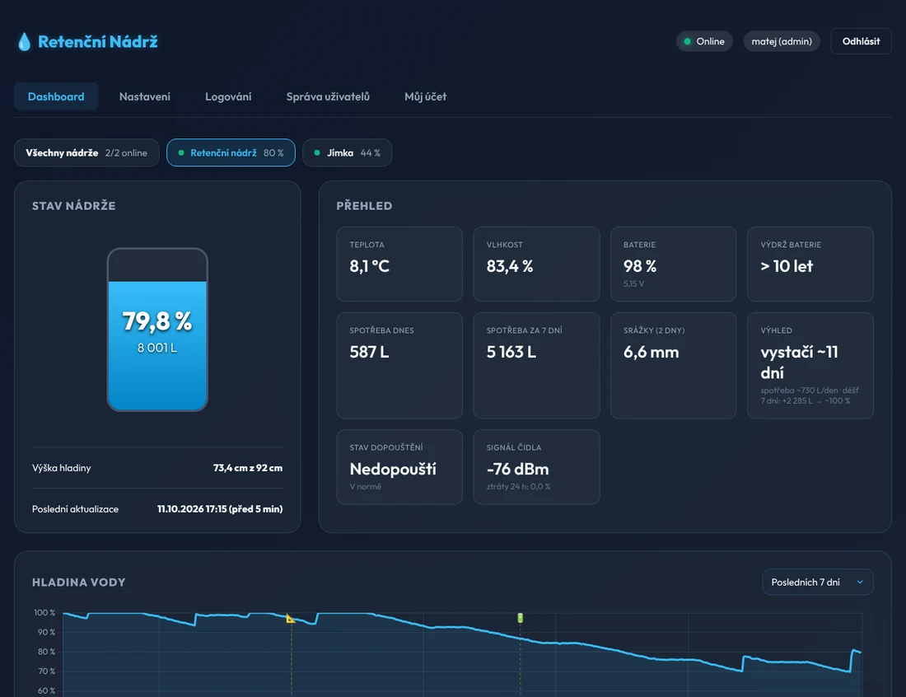
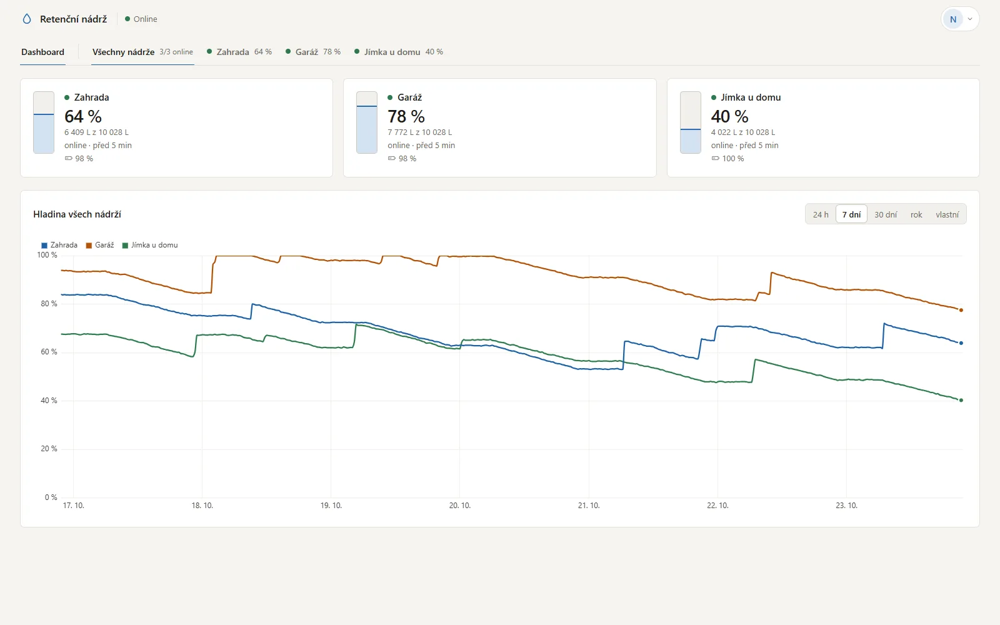
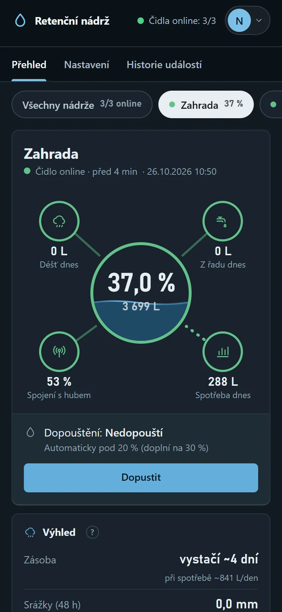
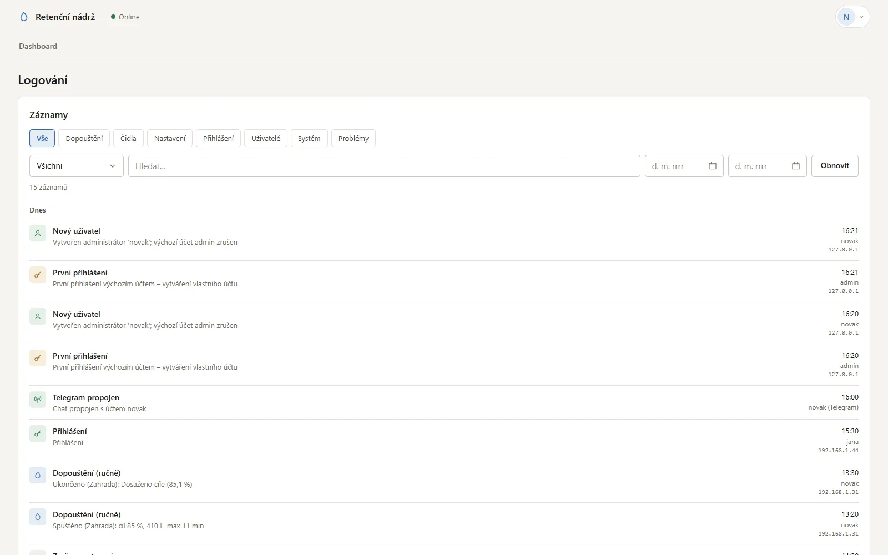

# 💧 Retenční nádrž – bezdrátové měření hladiny


Bezúdržbový systém pro retenční nádrž: bateriové čidlo v šachtě měří každých 5 minut hladinu,
teplotu a vlhkost a posílá je šifrovaně rádiem (433 MHz) na Raspberry Pi. Pi data ukládá, zobrazuje
na webu (i přes Cloudflare), poskytuje je Home Assistantu a umí řídit dopouštění přes Hunter Hydrawise.

<p align="center">
  
</p>

```
 ┌──────────── šachta ───────────┐          ┌──────── dům ─────────────────────────────┐
 │ ATtiny1624 + SHT40 + sonda    │  433 MHz │ Pi Zero 2 W + CC1101                      │
 │ 3× Li-FeS2, ~12 µA průměr     │ ───────► │  :80   web (login, grafy)  ◄── Cloudflare │
 │ 23 B šifr. / 5 min (1 min při │          │  :8081 Home Assistant (LAN, token)        │
 │ rychlé změně hladiny)         │          │  Wi-Fi hotspot + portál, mDNS, OTA         │
 └───────────────────────────────┘          └──────────────────────────────────────────┘
```

## Co umí

**Čidlo**
- Měření hladiny (hydrostatická sonda), teploty a vlhkosti v šachtě; baterie 1× za hodinu.
- Výdrž na 3× AA Li-FeS2 omezuje hlavně samovybíjení (10+ let); při nízké baterii varuje a na konci životnosti článků (1,0 V/článek) se samo vypne, aby se článek nepřepóloval.
- Šifrované a podepsané pakety (AES-128-CTR + CMAC, klíč z párování X25519), ochrana proti přehrání.
- **Čidlo patří svému hubu** – cizí hub ho nepřevezme; odpárovat jde jen z hubu + vložením baterie.

**Hub a web**
- Více nádrží na jeden hub (až 16), přehled **Všechny nádrže** i detail každé nádrže.
- Grafy kreslí prohlížeč: hladina s vyznačeným **dopouštěním** a **přítokem z deště** (jemně podbarvené
  úseky od–do s přerušovanými hranami, v tooltipu litry), spotřeba, dopouštění, klima, počasí, baterie a signál (s vyznačenou výměnou
  baterie); vlastní rozsah od–do.
- **Výhled:** na kolik dní voda vystačí a kolik přiteče z předpovídaného deště.
- **Chytré dopouštění:** když má brzy pršet a déšť nádrž doplní, hub nedopouští a čeká; když déšť nepřijde
  nebo hladina klesne příliš, dopustí – a jen tolik, kolik déšť nedodá.
- Dopouštění pro každou nádrž zvlášť (Hydrawise) – automatika, odložení při dešti, pojistky;
  jeden ventil ovládá vždy jen jedna nádrž (nikdy se nedopouští 2×).
- Přihlášení s rolemi (admin / uživatel), přehledný log s filtry, nastavení **základní / pokročilé**, jen pro admina.
- Plně funkční na mobilu.
- Home Assistant přes REST (YAML se vygeneruje sám), CSV export.
- Záloha i obnova přes web (nahraná data se sloučí bez duplicit), noční zálohy. Data se nemažou (~10 MB na čidlo a rok).
- Wi-Fi hotspot s portálem pro první nastavení, `retencka.local`, aktualizace z GitHubu s podpisem a rollbackem.
- Proces ~28–35 MB RAM, bez Dockeru a bez pip – jen standardní knihovna Pythonu.

<p align="center">
  
  
</p>
<p align="center">
  
</p>

## Rychlý start
Na Raspberry Pi OS Lite (po SSH) jediný příkaz – sám doinstaluje vše potřebné a na konci vypíše adresu,
heslo a kontrolu:
```bash
curl -fsSL https://raw.githubusercontent.com/Svaty10/Retencni_Nadrz_V2/main/system/bootstrap.sh | sudo bash
```
Alternativa přes git:
```bash
git clone https://github.com/Svaty10/Retencni_Nadrz_V2.git && cd Retencni_Nadrz_V2 && sudo ./system/install.sh
```
Pak `http://retencka.local` → první přihlášení `admin` + heslo ze štítku (`/boot/firmware/retencka.txt`)
→ vytvoření vlastního účtu. Funguje na Pi Zero 2 W i Pi 3 B/3 B+/4.
Podrobně v [docs/instalace.md](docs/instalace.md).

## Struktura repozitáře
| Složka | Obsah |
|---|---|
| [`uzel/`](uzel/) | firmware čidla (C, avr-gcc ≥ 12) |
| [`server/`](server/) | aplikace na Pi (Python 3.11+, **jen standardní knihovna** + spidev) |
| [`system/`](system/) | instalace, systemd služby, Wi-Fi hotspot/portál, mDNS, aktualizace |
| [`docs/`](docs/) | dokumentace (viz níže) |

## Dokumentace
| Dokument | O čem |
|---|---|
| [Zadání a návrh](docs/ZADANI.md) | kompletní specifikace: měření, protokol, párování, server, bezpečnost |
| [Instalace a provoz](docs/instalace.md) | instalace, uvedení do provozu, baterie, odpárování, záloha a obnova, problémy |
| [Zapojení](docs/zapojeni_rpi.md) | CC1101 ↔ Raspberry Pi |
| [Programování čidla](docs/programovani_uzlu.md) | nahrání firmwaru přes UPDI (USB-UART nebo Arduino), fuses, řešení problémů |
| [Architektura](docs/architektura.md) | jak je systém poskládaný, výpočty, řízení dopouštění |
| [API](docs/api.md) | REST API webu a Home Assistantu, rádiový protokol |
| [Home Assistant](docs/home_assistant.yaml) | vzorová konfigurace (aktuální YAML vygeneruje web) |
| [Changelog](CHANGELOG.md) | historie verzí |

## Firmware čidla
```bash
cd uzel
make                 # build/firmware.hex  (~9 kB flash z 16 kB)
make test            # self-test kryptografie proti oficiálním vektorům (na PC)
make fuses PORT=COM3 # jednou na čip
make flash PORT=COM3 # SerialUPDI
```
Fuse `EESAVE` zachová klíč i při přehrání firmwaru. Ladicí konstanty jsou v
[`uzel/include/config.h`](uzel/include/config.h). Kalibrace hladiny se dělá na serveru.

### Energetický rozpočet (odhad)
| Fáze | Proud | Doba | Náboj / cyklus |
|---|---|---|---|
| Spánek (PIT + WDT, CC1101 SLEEP) | ~1,5 µA | trvale | – |
| Sonda (boost 5 V + sonda) | ~5–6 mA | ~0,25 s | ~1,4 mAs |
| Šifrované vysílání +10 dBm (53 ms + kalibrace) | ~30 mA | ~58 ms | ~1,7 mAs |
| SHT40, CPU, baterie (1×/h) | – | – | ~0,1 mAs |

Při 5min intervalu ≈ 3,3 mAs/cyklus → ~12 µA průměrně → výdrž 3× AA Li-FeS2 (3000 mAh) omezuje hlavně
samovybíjení (10+ let). Kdyby čidlo měřilo trvale 1× za minutu: ~57 µA → teoreticky ~6 let, reálně ~5 let.
Proto měří po minutě jen při změně hladiny (dopouštění, déšť). Skutečnou spotřebu sondy ověřte měřením.

## Vývoj a testy
```bash
cd server
python3 -m unittest discover -s tests                       # testy serveru (bez hardwaru)
RETENCKA_DATA=/tmp/rt python3 tools/seed_demo.py 30         # demo data
RETENCKA_DATA=/tmp/rt RETENCKA_MOCK=1 RETENCKA_WEB_PORT=8080 python3 -m retencka
```
