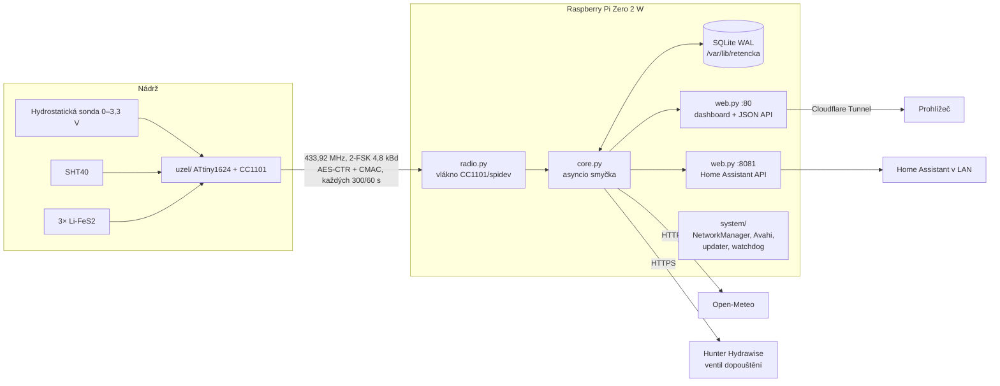
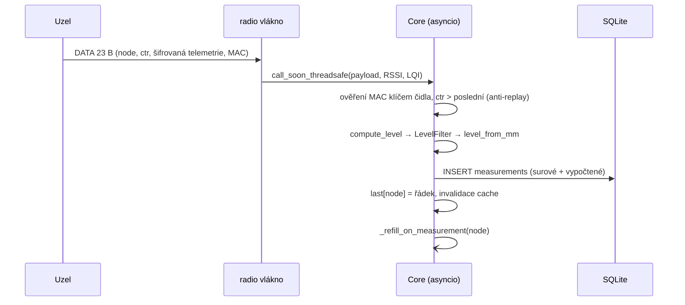
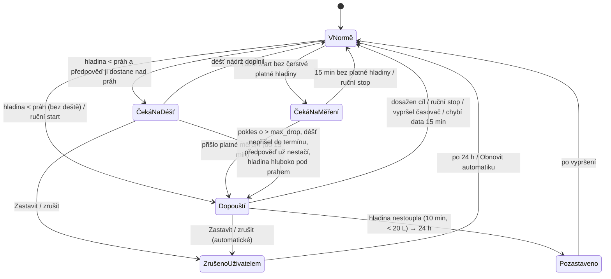

# Architektura – Retenční nádrž

Popis toho, jak je systém poskládaný a jak teče data. Závazné požadavky jsou v
[ZADANI.md](ZADANI.md), HTTP API v [api.md](api.md).

## 1. Přehled



| Část | Jazyk | Kde běží | Úkol |
|---|---|---|---|
| `uzel/` | C (avr-gcc), bare-metal | ATtiny1624 v nádrži | měří, šifruje, vysílá; nic nepočítá do cm |
| `server/` | Python 3 jen se std. knihovnou + `python3-spidev` | Pi, služba `retencka` | příjem, výpočty, DB, web, HA, řízení ventilu |
| `system/` | bash/Python + systemd | Pi | Wi-Fi provisioning, mDNS, aktualizace, odolnost |

Základní princip: **uzel posílá surové hodnoty** (napětí sondy v 0,1 mV, baterie v mV, teplota,
vlhkost, flagy) a **všechno odvozené počítá hub**. Kalibrace, geometrie nádrže i filtry se proto
mění bez přeflashování čidla a historii jde zpětně přepočítat.

## 2. Senzorový uzel (`uzel/`)

| Soubor | Obsah |
|---|---|
| `main.c` | hlavní smyčka: spánek (RTC PIT), měření, adaptivní interval 300 s / 60 s, rychlé kontroly, párovací okno |
| `sched.h` | čisté funkce plánovače a spouštěče rychlých kontrol (host test `tools/sched_test.c`, `make test`) |
| `adc.c` | ADC0 tinyAVR-2: sonda 16 dávek × 64 vzorků, ořezaný průměr; baterie medián 4 dávek |
| `sht40.c` | I²C, high-precision měření, CRC-8 |
| `cc1101.c` | rádio, stejná sada registrů jako `server/retencka/radio.py` |
| `crypto.c`, `link.c`, `proto.c` | AES-128, CMAC, X25519, párování, čítač rámců v EEPROM |
| `power.c` | spánek, watchdog, spínání 5V boostu a děliče baterie |

Přepočet ADC → napětí (vše v celých číslech, 32 bit):

- sonda: `pin[10 µV] = x16 · 250000 / 65536`, `sonda = pin · (100k + 220k) / 220k`, výstup v 0,1 mV
- baterie: `pin[µV] = x16 · 1024000 / 65536`, `Ubat = pin · (1M + 220k) / 220k`, výstup v mV

Rychlý režim: změna sondy > `FAST_DELTA_100UV` (10 mV ≈ 6 mm) → další měření za 60 s,
zpět na 300 s po 3 klidných měřeních, max. 90 rychlých cyklů.

Rychlé kontroly (fw ≥ 11): v normálním režimu se uzel probouzí každých `QUICK_CHECK_S`
(fw 11 a ≥ 13: 60 s, fw 12: 150 s) a změří jen sondu (bez SHT40, baterie, rádia a ohřevu, ≈ 1,4 mAs).
Jeden plánovač pro obojí – po každém vysílání se vylosuje perioda 300 s ± 8 s a uzel k ní kráčí
po `QUICK_CHECK_S`:

```
fw 11, 13:  TX ──60── Q ──60── Q ──60── Q ──60── Q ──52…67── TX
fw 12:      TX ──150── Q ──142…157── TX
```

Poslední krok je zbytek do plného cyklu, takže kontrola a plný cyklus nikdy nesplynou a jitter
posouvá jen vysílání. Kontrola porovná sondu s poslední *odeslanou* hodnotou; |Δ| ≥
`FAST_DELTA_100UV` (10 mV ≈ 6 mm) ve `QUICK_CONFIRM` kontrolách po sobě → hned plný cyklus
s vysíláním. Fw 13 (`QUICK_CONFIRM` = 2, každých 60 s): změnu ohlásí do 2 minut a o rychlém
režimu rozhodne až plné měření z vlastní hodnoty, takže šum stojí nanejvýš jeden paket navíc.
Fw 12 kontroloval jednou za 150 s s jedním potvrzením, fw 11 každých 60 s a rychlý režim po
potvrzení vynutil. V rychlém režimu (perioda 60 s) se
kontroly nekonají, stejně tak v párovacím okně, nespárovaném stavu a po odpojení baterie.
Odhad výdrže na hubu (`node_check_mAs`) počítá 1440 − počet vysílání za den kontrol denně.

## 3. Hub (`server/retencka/`)

### 3.1 Moduly

| Modul | Odpovědnost |
|---|---|
| `__main__.py` | start, otevření DB (při poškození automatická obnova z noční zálohy; zrcadlení klíčů do `<db>.keys`), spuštění rádia a dvou HTTP listenerů, periodické úlohy, systemd `READY`/`WATCHDOG` |
| `radio.py` | `Receiver` – vlastní vlákno: konfigurace CC1101, příjem (GDO0 hrana přes gpiod, jinak polling), okamžitá odpověď na PAIR_REQ, samoopravy (kontrola registrů každých 30 s, reset po tichu) |
| `crypto.py` | čistý Python: AES-128, AES-CMAC, X25519, formát rámců v3 |
| `core.py` | `Core` – mozek: příjem rámců, párování, ukládání, živý stav, dopouštění, historie, údržba, zálohy |
| `model.py` | čisté výpočty bez I/O: kalibrace, hladina/objem, filtr, mrtvé pásmo, baterie, toky (spotřeba/přítok) |
| `settings.py` | typované a validované nastavení v SQLite: globální `Settings` + `Nodes` (konfigurace každého čidla) |
| `db.py` | SQLite (WAL, `synchronous=NORMAL`), připojení na vlákno, verzované migrace |
| `external.py` | HTTPS klient přes `urllib` ve worker vlákně; `Weather` (Open-Meteo, cache 1 h), `Hydrawise` (REST `setzone.php`) |
| `httpserver.py` | minimální striktní HTTP/1.1 server nad asyncio (limity hlaviček, bez chunked požadavků) |
| `web.py` | routy webu a HA API, kontrola rolí, CSRF, bezpečnostní hlavičky |
| `auth.py` | uživatelé (scrypt), session v DB, rate limiting |
| `telegram.py` | Telegram bot: propojení chatů s účty, příkazy, upozornění (long polling ve vlastním vlákně) |
| `pngchart.py` | graf hladiny do PNG jen se standardní knihovnou (pro Telegram) |
| `static/` | web bez frameworku: `index.html` (SVG ikony jako sprite), `css/style.css` (barvy jako proměnné, světlý/tmavý režim podle systému), `js/app.js` (vykreslení, grafy Chart.js podle barev motivu), `js/i18n.js` (překlad rozhraní čeština ↔ angličtina za běhu, volba uložená u účtu a v `localStorage`), `js/theme.js` (motiv před vykreslením stránky); vše lokálně, bez CDN a webových fontů |

### 3.2 Vlákna

| Vlákno | Co dělá | Komunikace |
|---|---|---|
| hlavní (asyncio) | HTTP, `Core`, periodické úlohy | – |
| `radio` | SPI/GPIO, čtení FIFO, odpověď na párování | `loop.call_soon_threadsafe(core._on_frame)`; `core.responder()` volá přímo pod `_pair_lock` |
| `worker` ×3 | HTTPS volání, agregace, údržba, přepočet historie, import zálohy | `asyncio.to_thread` |

Každé vlákno má vlastní SQLite připojení (WAL dovoluje souběžné čtení se zápisem).

### 3.3 Cesta jednoho měření



### 3.4 Výpočetní řetězec (`model.py`)

| Krok | Vzorec | Jednotky |
|---|---|---|
| napětí sondy | `mV = probe_100uv / 10` | mV |
| vodní sloupec nad sondou | po částech lineární interpolace přes `cal_points`, mimo rozsah extrapolace krajním úsekem | cm |
| výška hladiny | `h = clamp(sloupec + sensor_offset_cm, 0, max_depth_cm)` | cm |
| objem | `V = plocha_m² · h_cm / 100 · 1000 = plocha · h · 10` | L |
| zaplnění | `h / max_depth · 100` | % |
| mrtvé pásmo | `přesnost_% / 100 · rozsah_cm · 10` (min. 1 mm); v litrech `· plocha · 10 / 10` | mm, L |
| filtr | medián posledních 3 → změna < 2× mrtvé pásmo: EMA α = 0,3, jinak skok; **během dopouštění bez vyhlazení** (surová hodnota) | mm |
| spotřeba / přítok | hystereze na vyhlazeném objemu s ½ mrtvého pásma (min. 5 L); stoupání při dopouštění = „refill“, jinak „rain“ | L |
| přítok z deště | `srážky_mm · plocha_střechy_m² · odtokový_součinitel` (1 mm na 1 m² = 1 L) | L |
| baterie % | vybíjecí křivka na článek (3 články) podle typu baterie u čidla: Li-FeS2 (plochá, 1,48 V ≈ 50 %) nebo alkalická (klesá průběžně, 1,30 V ≈ 50 %); 1,0 V = 0 % | % |
| výdrž baterie | `kapacita · % / (cykly/den · mAs/cyklus + µA_spánek · 86,4 + 2 %/rok samovybíjení)` | dny |
| výhled | `objem / průměrná denní spotřeba (posledních ≤ 7 celých dní)` | dny |

Časy předpovědi Open-Meteo chodí jako epoch (`timeformat=unixtime`), dny podle kalendáře místa
(`timezone=auto`); hodinová hodnota v čase T = srážky hodiny končící v T. Denní součty spotřeby
se počítají v místním čase Pi – zónu nastavuje `install.sh` (výchozí Europe/Prague).

Do DB se ukládá surové `probe_100uv`, nefiltrovaná výška `level_raw_mm`, filtrovaná `level_mm`
a `volume_l`. Po uložení kalibračního bodu nebo parametru, na kterém hladina či objem závisí (`RECALC_KEYS`
ve `web.py`), projde hub historii čidla znovu na pozadí (`Core.recompute_levels`); změna uložená během
přepočtu spustí ještě jeden průchod. Tlačítko *Přepočítat* to umí spustit ručně.

### 3.5 Řízení dopouštění

Každé čidlo má vlastní ventil (provider). Dnes `hydrawise`; ventil identifikuje trojice
(provider, API klíč, relay ID). Když stejný ventil nastaví víc čidel, ovládá ho jen první v
seznamu (`Core.zone_owner`).



- Doba běhu: `potřeba_L / průtok_L·min⁻¹ · 60 · 1,10`, max. `max_refill_minutes`. Stejný čas
  dostane i časovač ventilu v Hydrawise – ventil se zavře i když hub mezitím spadne.
- Uzavřená smyčka: každé měření porovná hladinu s cílem a při dosažení ventil zastaví. Během dopouštění
  filtr nevyhlazuje (sleduje surovou hodnotu) – jinak by se ventil zavíral pozdě a doběh filtru po
  skončení by se v grafech a součtech objevil jako „přítok z deště“.
- Start i stop ventilu jsou serializované (`Core._refill_lock`), ruční a automatický start se nepotkají.
- Průtok se kalibruje během dopouštění (po ≥ 120 s a ≥ 50 L): `real_flow = 0,7 · staré + 0,3 · naměřené`.
- Při předpovězeném dešti se dopouští jen část: `cíl' = max(min(cíl, práh + 2), cíl − přírůstek_z_deště)`.
- Ventil nikdy nejede „naslepo“: start vyžaduje platnou hladinu ne starší 15 min. Automatika se spouští
  právě po novém měření; ruční start bez platných dat se uloží (`Core.refill_wait`, na webu „Čeká na
  měření“) a spustí se s příštím platným měřením, nejdéle do 15 min, jinak propadne (záznam + upozornění).
- Nepotvrzené zastavení ventilu se opakuje každých 30 s; 24h pozastavení kvůli poruše jen když dopouštění
  doběhlo do konce časovače a hladina (platná) nestoupla.
- Pojistka při nejistém startu: pokud volání `run` na Hydrawise selže (např. timeout), hub neprodleně odešle
  preventivní `stop` a při neúspěchu zařadí dopouštění do `stop_retry`, takže `refill_tick` opakuje zastavení ventilu.
- Zrušení (`Core.refill_cancel`, tlačítko *Zastavit / zrušit*, Telegram `stop`) funguje kdykoli: čekající
  ruční požadavek se zahodí, běžící dopouštění zastaví; u automatiky (běžící i čekání na déšť) se navíc
  automatika té nádrže pozastaví na 24 h (uloženo v DB, přežije restart), jinak by ji spustilo hned další
  měření. *Obnovit automatiku* / Telegram `obnovit` pozastavení zruší.
- `refill_tick` (každých 30 s): pojistky časovače a výpadku dat, propadnutí čekajících požadavků.

### 3.6 Databáze (`db.py`, migrace v1–v14)

| Tabulka | Obsah |
|---|---|
| `measurements` | jedno měření = jeden řádek: `ts, node_id, seq, flags, vbat_mv, temp_x100, hum_x100, probe_100uv, level_mm, level_raw_mm, volume_l, rssi_x2, lqi, refilling, time_ok` |
| `hourly` | hodinové agregace na čidlo (grafy nad 45 dní, zůstávají i po mazání podrobných dat) |
| `nodes` | čidla: název, JSON konfigurace (geometrie, kalibrace, dopouštění), klíče, stav párování (`unpair_at`, `unpair_sent_at`), `last_ctr` |
| `node_key_archive` | čekající klíče z párování a klíče odebraných čidel (jen pro podpis UNPAIR, viz 3.9) |
| `settings` | globální nastavení (klíč → JSON) |
| `refills` | každé dopouštění: start/konec, cíl, litry, plánovaný čas, výsledek |
| `users`, `sessions` | účty (scrypt, motiv `theme` a jazyk rozhraní `lang` u účtu), session (hash tokenu, CSRF token) |
| `audit` | záznamy (log) |

Grafy: SQL bucketing `(ts / bucket) * bucket`, bucket zvolený tak, aby vyšlo ≤ ~600 bodů;
nad 45 dní se čte z `hourly`.

Odolnost databáze: Při poškození SQLite databáze se při startu automaticky vyhledá a obnoví poslední validní noční záloha. Klíče spárovaných čidel jsou navíc trvale zrcadleny do atomického souboru `<db>.keys`, aby nedošlo ke ztrátě párování ani při úplné havárii databáze.

### 3.7 Periodické úlohy (`__main__.periodic`)

| Perioda | Úloha |
|---|---|
| ½ `WatchdogSec` (30 s) | systemd watchdog (jen když žije i rádiové vlákno) |
| 30 s | `refill_tick`, `time_tick` (posun měření po pozdní synchronizaci času) |
| 1 h | `aggregate_hours` |
| 1 den | retence, hlídání místa na kartě, mazání starých session, `PRAGMA optimize`, lokální záloha (7 dní) |

### 3.8 Nastavení

Globální (`settings.SCHEMA`): poloha (`latitude`, `longitude`, `location_name` z hledání obce),
Hydrawise API klíč účtu, energetický model čidla (spotřeba měření/spánku/ohřevu), `stale_timeout_s`,
`retention_days`.

Každé čidlo (`settings.NODE_SCHEMA`): geometrie nádrže, kalibrace a přesnost sondy, střecha,
typ, kapacita a korekce baterie a celé dopouštění včetně průtoku z řádu (`flow_rate_lpm`, v UI pod *Pokročilé*).

Převod parametrů z původního prototypu (Flask + ESP32):

| Původní prototyp | Nová verze | Poznámka |
|---|---|---|
| `tank_area_m2`, `max_depth_cm`, `sensor_offset_cm` | stejné, per čidlo | |
| `flow_rate_lpm` | `flow_rate_lpm` (per čidlo) | + `max_refill_minutes` jako horní mez |
| `real_flow_rate_lpm` (state) | `real_flow_rate_lpm` (per čidlo, interní) | vyhlazeno EMA |
| `refill_threshold_pct` | `refill_threshold_pct` + `auto_refill_target_pct` | dřív práh = cíl (hystereze 1 %) |
| `max_refill_pct` | `max_refill_pct` | |
| — (automatika vždy zapnutá) | `auto_refill_enabled`, `refill_provider` | |
| `hydrawise_api_key`, `hydrawise_relay_id` | globální klíč + volitelný klíč čidla, `hydrawise_relay_id` per čidlo | |
| `latitude`, `longitude` | stejné | |
| `catchment_area_m2` | `catchment_area_m2` + `runoff_coef` | |
| `rain_defer_enabled`, `rain_defer_threshold_mm` | `rain_wait_enabled`, `rain_wait_hours`, `rain_wait_max_below_pct`, `rain_wait_max_drop_pct` | místo pevných 5 mm se počítá přírůstek % |
| `cal_v1…cal_v3`, `cal_d2…cal_d4` | `cal_points` (2–8 bodů, mV → cm) | nový ADC je lineární |
| `measurement_tolerance_pct` | `probe_accuracy_pct` × `probe_range_cm` | mrtvé pásmo podle datasheetu sondy |
| `battery_multiplier` | `battery_trim` (±20 %) | dělič přepočítává už uzel |
| `interval_*`, `night_*`, `wakeup_mode`, `sync_*`, `active_polling_interval_sec`, `warmup_window_sec`, `sensor_samples`, `esp_api_key`, `calibration_mode`, `update_mode` | — | relikty ESP32/Wi-Fi, nahrazeno rádiem a pevným časováním uzlu |

### 3.9 Párování a odpárování – stavy a scénáře

Klíče hubu k jednomu ID čidla (`core.py`):

| Klíč | Kde | Přijímá data? | K čemu |
|---|---|---|---|
| aktuální | `nodes.secret` | ano | běžný provoz |
| čekající (*pending*) | `node_key_archive`, `reason='pending'` + paměť | ano, první ověřený DATA ho potvrdí (`_commit_pairing`) | klíč z PAIR_ACK po potvrzení uživatelem; platí `PENDING_KEY_S` = 24 h i po zavření okna párování a přežije restart |
| archivní | `node_key_archive` (`removed` / `unpaired` / `expired` / `cancelled`) | **nikdy** | jen podpis UNPAIR, aby šlo čidlo, které klíč ještě drží, uvolnit bez UPDI; `seen_at` = čidlo s ním ještě vysílá |

Pravidla hubu:
- PAIR_ACK jen pro ID potvrzené uživatelem (`start_pairing`, 15 min), nikdy automaticky.
- UNPAIR jen na *spárovaný* PAIR_REQ a jen když uživatel o ID požádal (odpárování nebo párování).
  Hub neví, který klíč čidlo drží (PAIR_REQ není podepsaný): střídá aktuální → klíč viděný v datech →
  nejnovější čekající/archivní, jeden na každý dotaz (čidlo se ptá každých 5 s po 10 min).
- Nespárovaný PAIR_REQ potvrzuje odpárování jen poté, co hub poslal UNPAIR (čas uložen v
  `nodes.unpair_sent_at`, přežije restart). Klíč se smaže až po `UNPAIR_SETTLE_S` bez spárovaného
  dotazu; i pak skončí v archivu, takže ani podvržené potvrzení čidlo nezamkne.
- Při změně klíče (`_commit_pairing`) se anti-replay čítač vynuluje; nic jiného ho nemění (neověřené
  rámce ani PAIR_REQ). Čekající i archivní klíče daného ID se smažou.

| # | Situace | Čidlo | Hub | Výsledek / obnova |
|---|---|---|---|---|
| – | nové čidlo, uživatel potvrdí ID | nespárované: PAIR_REQ 5 s (10 min), pak 1 min, po dni 5 min | PAIR_ACK → klíč čekající; první DATA → aktuální | spárováno |
| 1 | *Odebrat bez čidla* (`forget_node`), čidlo se najde | drží klíč, vysílá DATA | klíč v archivu, data nebere, v „Čidla v dosahu“ cizí čidlo + **Spárovat znovu** | Spárovat znovu + vyjmout/vložit baterii → UNPAIR archivním klíčem → PAIR_ACK → DATA; název z archivu |
| 2 | ztracený první DATA po PAIR_ACK | spárované novým klíčem, vysílá DATA (60 s, pak 300 s) | klíč čekající 24 h (i po restartu) | první doručený DATA spáruje; po 24 h klíč do archivu → jako 1 |
| 3 | restart hubu během odpárování | po UNPAIR nespárované, PAIR_REQ 5 s / 1 min | `unpair_sent_at` z DB | nespárovaný dotaz potvrdí, po 20 s odebráno |
| 4 | čidlo ztratilo klíč (smazaná EEPROM, nový čip se stejným ID) | nespárovaný PAIR_REQ | ID známé, „čidlo ztratilo klíč“ + **Znovu spárovat**; bez potvrzení nic nemění | potvrzení → PAIR_ACK → DATA; název, nastavení i historie zůstanou |
| 5 | odpárování, čidlo neodpoví (baterie, porucha) | – | data blokována | *Zrušit* (data zase platí) nebo *Odebrat bez čidla* (→ archiv, jako 1) |
| 6 | znovu spárovat spárované čidlo | po vložení baterie spárovaný PAIR_REQ | UNPAIR aktuálním klíčem, pak PAIR_ACK; běžící odpárování se zruší, nečeká se na 20 s | ztracený UNPAIR / PAIR_ACK: čidlo se za 5 s zeptá znovu, odpověď je stejná (stejný klíč) |
| 7 | na PAIR_ACK odpověděl dřív jiný hub | spárované s cizím hubem | data neověří (žádné čítače chyb, žádná upozornění), čekající klíč po 24 h do archivu bez `seen_at` | čidlo patří tomu hubu; tady jen „cizí čidlo“ |
| 8 | výměna baterie jiného čidla během párování | spárovaný PAIR_REQ jiného ID | bez potvrzení toho ID žádná odpověď | nic se nemění |
| 9 | podvržený DATA / PAIR_REQ | – | neověřený rámec nemění čítač ani klíče | – |
| – | čidlo spárované s jiným hubem / před přeinstalací hubu bez zálohy | drží klíč, který hub nezná | cizí čidlo bez archivu: nápověda | jen smazání párování přes UPDI (`uzel/4-smazat-parovani.cmd`) |

Zálohy: `node_key_archive` je v DB, takže je ve stažené záloze; import (`_merge`) archivní klíče přidá
(čekající z cizí zálohy jen jako archivní – data s nimi nikdy neplatí). Starší záloha bez tabulky jde
importovat beze změny.

## 4. Systémová vrstva (`system/`)

| Jednotka | Úkol |
|---|---|
| `retencka.service` | aplikace (`python3 -m retencka`), `MemoryMax=128M`, `WatchdogSec=60`, `Restart=always` |
| `retencka-identity.service` | hostname `retencka-xxxx`, heslo hotspotu, setup kód |
| `retencka-netwatch.service` | hlídá Wi-Fi, bez spojení spustí hotspot |
| `retencka-portal.service` | captive portál pro zadání Wi-Fi (jen v režimu hotspotu) |
| `retencka-alias.service` | mDNS alias `retencka.local` (jen první zařízení v síti) |
| `retencka-update.timer/.path/.service` | denní / ruční aktualizace z GitHub Release, Ed25519 podpis, snapshot databáze a rollback (kód, jednotky i DB) |
| `retencka-control.path/.timer/.service` | akce s právy roota na žádost aplikace: restart zařízení, servisní přístup NetBird (24 h / trvale / vypnuto), úklid souborů HTTPS z verzí 1.7–1.9 |

Read-only root (overlayfs), data na `/var/lib/retencka`, logy v RAM, HW watchdog. Před přepnutím verze provede updater konzistentní snapshot SQLite databáze; při neúspěšné aktualizaci nebo selhání kontroly zdraví vrátí kód, systemd jednotky i stav databáze zpět.

## 5. Zdroje na Pi Zero 2 W

| Položka | Hodnota | Proč stačí |
|---|---|---|
| RAM | 512 MB, služba omezená na 128 MB | jeden Python proces bez frameworků ~20–30 MB RSS; scrypt 16 MB serializovaně |
| CPU | 4× Cortex-A53 | jeden paket za minutu: dešifrování ~ms; X25519 při párování desítky ms; grafy kreslí prohlížeč |
| Disk | ~10 MB na čidlo a rok | WAL, `commit=60`, hodinové agregace |
| Síť | jen 2,4 GHz Wi-Fi | |
